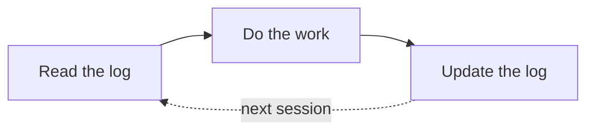

# Adi Mendelowitz

I'm a senior data scientist working on forecasting, anomaly detection and experiment design for operational data, and each project below links to its code, tests and results.

## Selected work

### [cd-ci-patchtst](https://github.com/AdiMendelowitz/cd-ci-patchtst): channel dependence in PatchTST

My paper in TMLR (2026) asks whether letting a forecasting model look at every channel at once is worth what it costs to train. On controlled synthetic data, accuracy stayed inside a 1% band fixed in advance, while a channel-dependent epoch on the ECL dataset took 6.7 times as long. The cheaper per-channel model was the better choice in every setting I tested, and the repository rebuilds every number in the paper in under a minute on a CPU.

  

### [ab-test-forensics](https://github.com/AdiMendelowitz/ab-test-forensics): how A/B tests reach the wrong decision

Case studies of experiments that went wrong, each built on data with a known ground truth so the damage can be measured. In the first case, lost scan logs make the dashboard's reading look like a win, while the analysis of every routed product stays inside the noise. There is a [blog post](https://blog.adimendelowitz.dev/ab-test-forensics/lost-logs-found-lift-part-1.html) that walks through it.

  

### [applied-ml](https://github.com/AdiMendelowitz/applied-ml): implementations from scratch

PyTorch and NumPy code I wrote across computer vision, adversarial attacks and forecasting, with 225 tests. One result I like: static INT8 quantisation made a ResNet-18 3.95 times smaller and 1.52 times faster at the same accuracy.

  

### [instrumented_skills](https://github.com/AdiMendelowitz/instrumented_skills): Claude Code skills with memory

Skills I built so that repeated work on the same file carries over between sessions. Each one logs its state outside the conversation and reads it back before acting, and the [blog series](https://blog.adimendelowitz.dev/skills/intro.html) explains the reasoning behind each.

## Background

After a B.Sc. in Mathematics, I spent six years in production ML, working with clinical data at GE Healthcare and leading the fleet data team at SolarEdge, where our monitoring and root-cause analysis fed decisions about which device faults to fix and how to roll the fixes out.

Tools I use most: Python, SQL, PyTorch, scikit-learn, statsmodels, Databricks and AWS.
